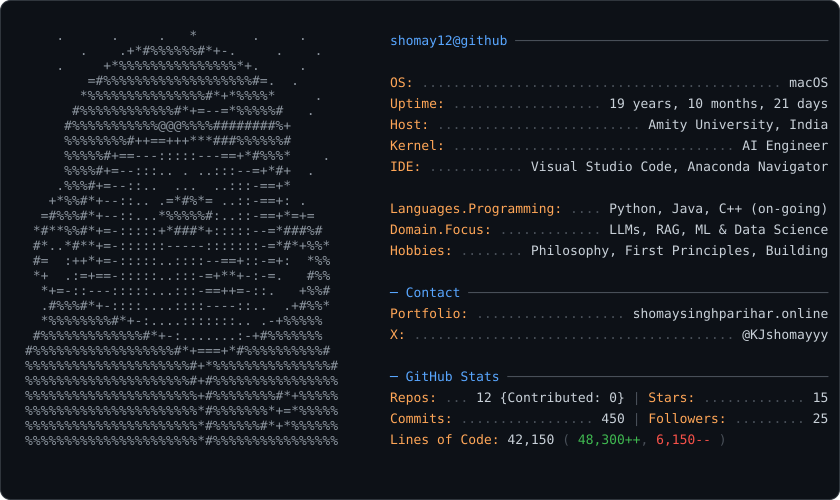

 

Building intelligent systems. Turning data into insights. Engineering software that works.

 

  

<picture>
  <source media="(prefers-color-scheme: dark)" srcset="dark_mode.svg">
  <source media="(prefers-color-scheme: light)" srcset="light_mode.svg">
  
</picture>

⸻

✦ Featured Work

<table>
<tr>
<td width="50%" valign="top">
<h3>🎓 <a href="YOUR_UNIASSIST_SOURCE_URL">UniAssist</a></h3>

RAG-Powered Academic Assistant

A Retrieval-Augmented Generation system that grounds language model outputs in coursework, syllabi, and technical textbooks. Features structure-aware chunking, sentence-transformer embeddings, FAISS similarity search, and Groq inference.

 

`Python` `RAG` `FAISS` `LangChain` `Groq` `Streamlit`

</td>
<td width="50%" valign="top">
<h3>💰 <a href="YOUR_FINANCE_SOURCE_URL">Finance Expenditure Intelligence</a></h3>

Data Science & Machine Learning

An end-to-end financial intelligence pipeline combining Isolation Forest anomaly detection, NLP-based transaction classification, recurring-payment detection, and time-series forecasting for cash-flow analysis.

 

`Python` `Scikit-learn` `Pandas` `NumPy` `Time Series` `Plotly`

</td>
</tr>
<tr>
<td width="50%" valign="top">
<h3>⚙️ <a href="YOUR_MONITORING_SOURCE_URL">Industrial Machine Monitoring</a></h3>

Predictive Maintenance

A machine-monitoring system that processes vibration, acoustic, and thermal sensor telemetry. Uses a RandomForest classifier to estimate equipment failure risk and a min-heap priority queue to prioritize maintenance.

 

`Python` `RandomForest` `FastAPI` `MongoDB` `Sensor Data` `DSA`

</td>
<td width="50%" valign="top">
<h3>🍵 <a href="YOUR_HOTTEA_SOURCE_URL">HotTea</a></h3>

Privacy-First AI Browser & LLM Workspace

A cross-platform AI workspace combining local inference through Ollama and llama.cpp with cloud LLMs. Includes DOM context extraction and a client-side AES-GCM-encrypted .tea vault.

 

`Flutter` `Dart` `Ollama` `Local LLMs` `AES-GCM` `Privacy`

</td>
</tr>
</table>

⸻

◈ AI Engineering & Data Science

| Area | Technologies & Methods |
| :--- | :--- |
| **LLM Engineering** | Transformers, prompt engineering, fine-tuning, PEFT |
| **RAG & Retrieval** | Embeddings, semantic search, retrieval pipelines |
| **AI Agents** | Tool calling, workflow orchestration, execution planning |
| **Data & ML** | NumPy, pandas, statistical learning, time-series forecasting |
| **Deep Learning** | PyTorch, neural networks, vision-language models |
| **Evaluation** | Benchmarking, classification metrics (F1, precision, recall), error analysis |

⸻

◈ Beyond Code

**First principles.** Understanding a problem before choosing a solution.

**Philosophy.** Exploring knowledge, reasoning, reality, and the questions behind our understanding of the world.

**Building.** Learning by implementing ideas, examining failures, and improving systems.

⸻

 

<a href="https://shomaysinghparihar.online">Portfolio</a> ·
<a href="https://github.com/Shomay12">GitHub</a> ·
<a href="https://x.com/KJshomayyy">X</a>

Shomay Singh Parihar · India

 

<a href="#top">↑ Back to top</a>

